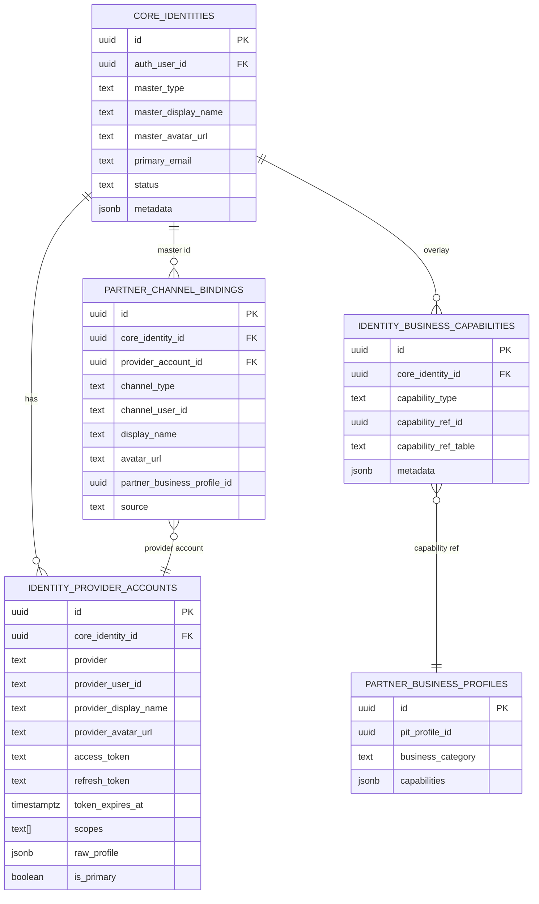
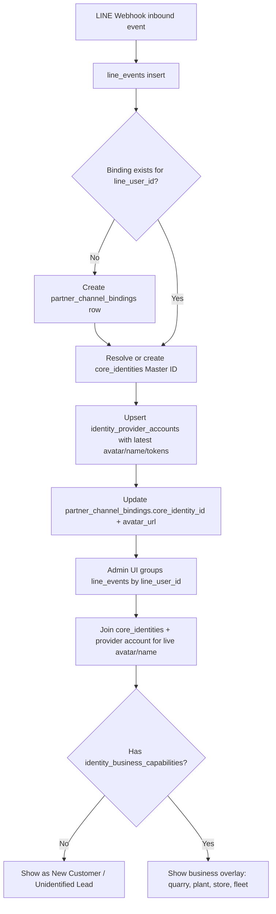

# Unified Identity Hub — 3-Layer Omnichannel Architecture

## Layer 1 — Core User Identity (Master ID)

- `core_identities`: one row per real person/entity (Master ID).
- `identity_provider_accounts`: OAuth/social/channel identities linked to a Master ID.
- `auth_user_id` optionally links to Supabase Auth (`auth.users`).

## Layer 2 — Omnichannel Channel Bindings (Ingestion Gate)

- `partner_channel_bindings` is the ingestion gate.
- Each row maps a channel-specific ID (`LINE` user ID, `PHONE`, etc.) to one `core_identity_id`.
- Chat events in `line_events` are grouped by `line_user_id` and resolved through this binding.

## Layer 3 — Business Capabilities & Assets (Overlay)

- `identity_business_capabilities` overlays business assets onto a Master ID without coupling chat ingestion to business logic.
- Existing `partner_business_profile_id` on bindings is backfilled into this overlay.

## ER Diagram

## Inbound Data Flow (LINE example)

## Notes

- Migration: `supabase/migrations/20261110190000_unified_identity_layer1_layer2.sql`
- Backfill created Master IDs for all existing channel bindings and LINE events with real IDs.
- Chat ingestion no longer depends on business profile existence.
